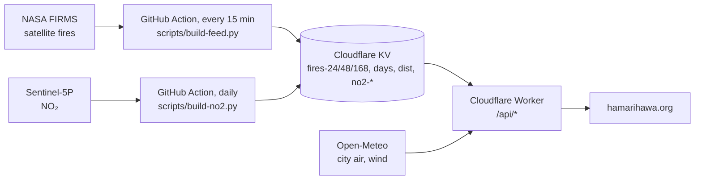

# HamariHawa

A live satellite map of fires, smoke and air pollution over Pakistan and North India, in English, Urdu and Hindi: **https://hamarihawa.org**

- **Live map**: every fire NASA's satellites see across the plains, named after the nearest village and tagged when it sits on a brick kiln, landfill or industrial estate. Layers for traffic and industry NO₂ (with major roads underneath), haze, smoke, clouds and wind, plus "your air" for the visitor's city.
- **City air**: PM2.5 and AQI for 17 cities, with cigarette and WHO-limit equivalents.
- **[Pollution sites](https://hamarihawa.org/sites/)**: landfills, power plants, industrial hotspots and kiln districts.
- **[Fire trends](https://hamarihawa.org/trends/)** and the **[Two Punjabs report](https://hamarihawa.org/report/two-punjabs/)**: every October–November crop-burning season since 2019, on both sides of the border.
- **[Open data](https://hamarihawa.org/data/)**: JSON feeds, Google Earth / GIS (KML) layers, and the daily fire archive.

## How it works



The heavy work (naming every fire after its village, merging duplicate detections, building the KML and the daily archive) runs in GitHub Actions, so the Worker only serves files from KV and caches them at the edge. Everything fits Cloudflare's free plan.

## Repository layout

- `site/`: Cloudflare Worker (`src/worker.js`, `src/kml.js`) plus the static site (`public/`). Plain HTML, CSS and JavaScript with Leaflet; there is no build step.
- `scripts/build-feed.py`: downloads NASA FIRMS fire detections (VIIRS + MODIS), names each fire after the nearest GeoNames village and writes the feed to Workers KV. Runs every 15 minutes from `.github/workflows/feed.yml`. It also keeps the daily archive in KV (`days` index, `dist` districts, `day-YYYY-MM-DD` spots, on Pakistan time) and adds a `trend` block to each feed.
- `scripts/backfill-days.py`: one-off fill of past days in the same archive from the FIRMS area API (needs a free MAP_KEY in `~/.config/hamarihawa/firms_key`). Seasons 1 Oct–30 Nov 2019–2025 are filled.
- `scripts/season-stats.py` + `scripts/build-report-punjabs.py`: Suomi NPP season statistics for the two Punjabs (from the backfill cache) and the Two Punjabs report built from them (`site/public/report/two-punjabs/`).
- `scripts/build-no2.py`: 14-day Sentinel-5P NO₂ average and labelled traffic/industry hotspots, uploaded to KV daily by `.github/workflows/no2.yml`.
- `scripts/build-places.py`: rebuilds the village index in `site/public/places/` from GeoNames dumps.
- `scripts/build-sites.py`, `scripts/build-sources.py`: the Pollution sites directory and source layers in `site/public/sources/`.
- `scripts/osm-industrial.py`: industrial estates, named fossil power plants and major roads (`--roads`) from Geofabrik OpenStreetMap extracts.
- `scripts/build-og-report.py`: the Two Punjabs link-preview card (`site/public/og/two-punjabs.png`), in the same style as `scripts/build-og.py`.
- `scripts/build-kml.py`: the pollution-sites layer for Google Earth (`site/public/kml/sources.kml`). `site/public/hamarihawa.kml` links it with the live layers the Worker serves.
- `scripts/build-pages.py`: builds `/data/`, `/trends/`, `/reports/`, the rolling `/updates/` page with its Atom feed, and `sitemap.xml` (dates from git). Page text is in `scripts/pages/{data,trends}-{en,ur,hi}.html`. To post an update, add an entry at the top of `site/public/updates/updates.json` and rerun it.
- `report/`: the 24-month Lahore and Islamabad Air Ledger, also served at `/report/`.
- `docs/IDEA.md`: the original plan, kept for history.

## Run it locally

You need Node 18+ and Python 3.11+. The scripts use only the Python standard library, except `build-no2.py` (Pillow) and `osm-industrial.py` (pyosmium).

```sh
# build a fire feed from NASA's public files into ./feed (no keys needed)
python3 -I scripts/build-feed.py --out feed

# serve the site with a local KV store
cd site
npx wrangler kv key put --binding FEED --local fires-24 --path ../feed/fires-24.json
npx wrangler kv key put --binding FEED --local fires-48 --path ../feed/fires-48.json
npx wrangler kv key put --binding FEED --local fires-168 --path ../feed/fires-168.json
npx wrangler kv key put --binding FEED --local days --path ../feed/days.json
npx wrangler dev --var DEV:1 --port 8791
```

Then open http://127.0.0.1:8791. `DEV:1` turns off the HTTPS redirect for local use. NO₂ layers stay empty until you run `scripts/build-no2.py` and load its output the same way.

## Deploy your own copy

1. Create a KV namespace (`npx wrangler kv namespace create FEED`) and put its id in `site/wrangler.jsonc` and in the two workflows.
2. Change or remove the custom-domain `routes` in `site/wrangler.jsonc`, then `cd site && npx wrangler deploy`.
3. In the GitHub repository, add the secret `CLOUDFLARE_API_TOKEN` (permission: Workers KV Storage, Edit) and the variable `CLOUDFLARE_ACCOUNT_ID`. Point `FIRMS_BASE` in `.github/workflows/feed.yml` at your own Worker's `/api/firms`, since GitHub's runners can't reach NASA directly.

## Check our numbers yourself

Nothing on the site needs to be taken on trust: the inputs are public and every step is in this repository. If you use a coding assistant (Claude Code, Cursor, GitHub Copilot and the like), point it at this repo and ask it to verify a claim. Some starting points:

- "Using `scripts/backfill-days.py` and `scripts/season-stats.py` with my NASA FIRMS key, rebuild `site/public/report/two-punjabs/seasons.json` from scratch and tell me whether every number in the Two Punjabs report matches."
- "Read `scripts/build-feed.py` and explain how a fire gets its village name and its 'likely type'. Find ways a fire could be tagged as a brick kiln or crop burning wrongly, and test a few against the live feed at https://hamarihawa.org/api/fires."
- "Compare the Indian Punjab season counts in `seasons.json` with India's official CAQM figures and explain the year where they disagree."
- "Check the health numbers in `site/public/app.js` (cigarettes, multiple of the WHO limit, years of life, extra deaths) against the sources cited on the About page."

A free FIRMS key is only needed to rebuild past seasons (https://firms.modaps.eosdis.nasa.gov/api/map_key). The live feed and the local site need no keys. If you find something wrong, open an issue.

## Contributing

Issues and pull requests are welcome, especially:

- **Translations**: Urdu and Hindi text lives in `site/public/i18n.js`, `scripts/pages/*-ur.html` / `*-hi.html` and `site/public/trends/trends.js`. Natural phrasing matters more than word-for-word accuracy.
- **Corrections** to place names, pollution sites or source classifications.
- **Ground truth**: if you know a fire we've labelled wrongly, tell us where.

Keep the site fast and dependency-free: no frameworks or build step. Write to hello@hamarihawa.org for anything else, and see `SECURITY.md` for security reports.

## Licences

Code: MIT (`LICENSE`). Data files have their own licences, mostly CC BY 4.0, with OpenStreetMap layers under ODbL and the brick-kiln data non-commercial (CC BY-NC 4.0). See `DATA-LICENSES.md` for each file. Please credit "HamariHawa (hamarihawa.org)" along with the original sources.

Fire data: NASA FIRMS. NO₂: Copernicus Sentinel-5P via NASA GIBS. Air quality and wind: Copernicus CAMS and Open-Meteo. Place names: GeoNames. Map data: © OpenStreetMap contributors. Base map: Esri.
